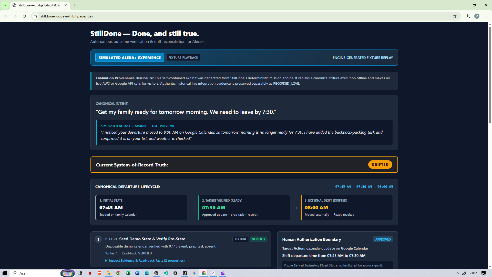
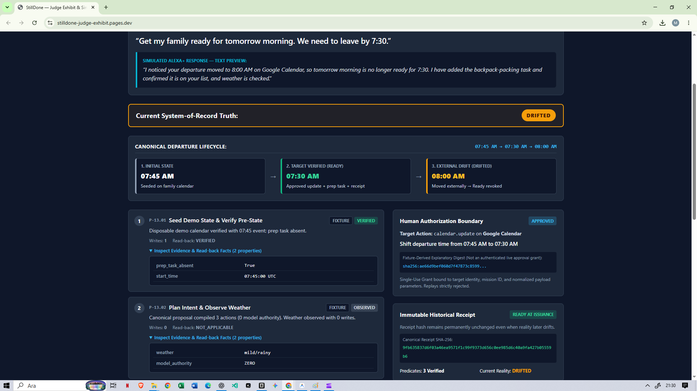
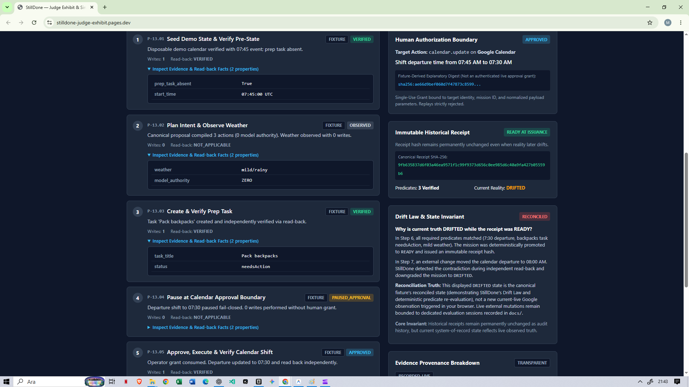
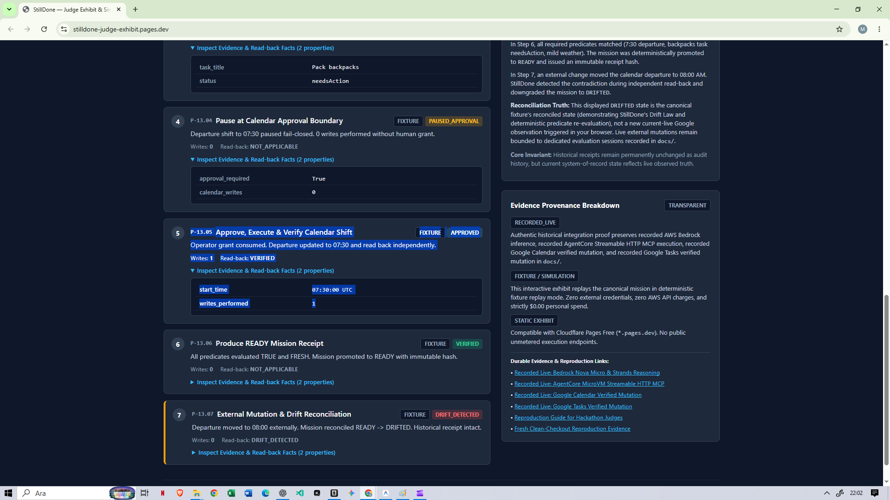
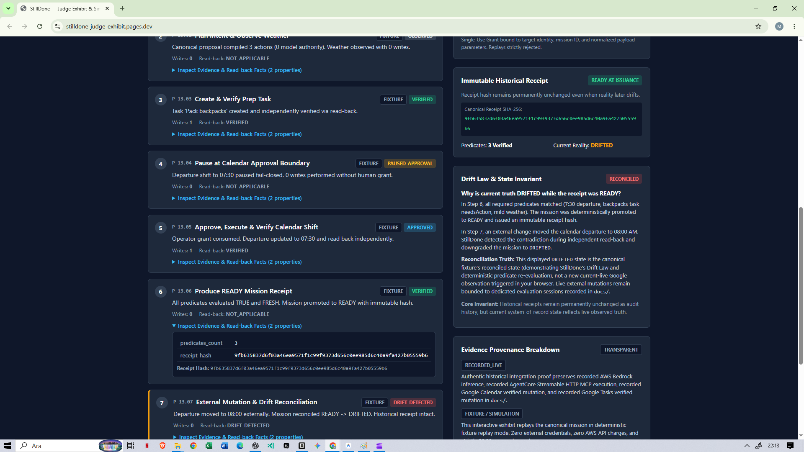
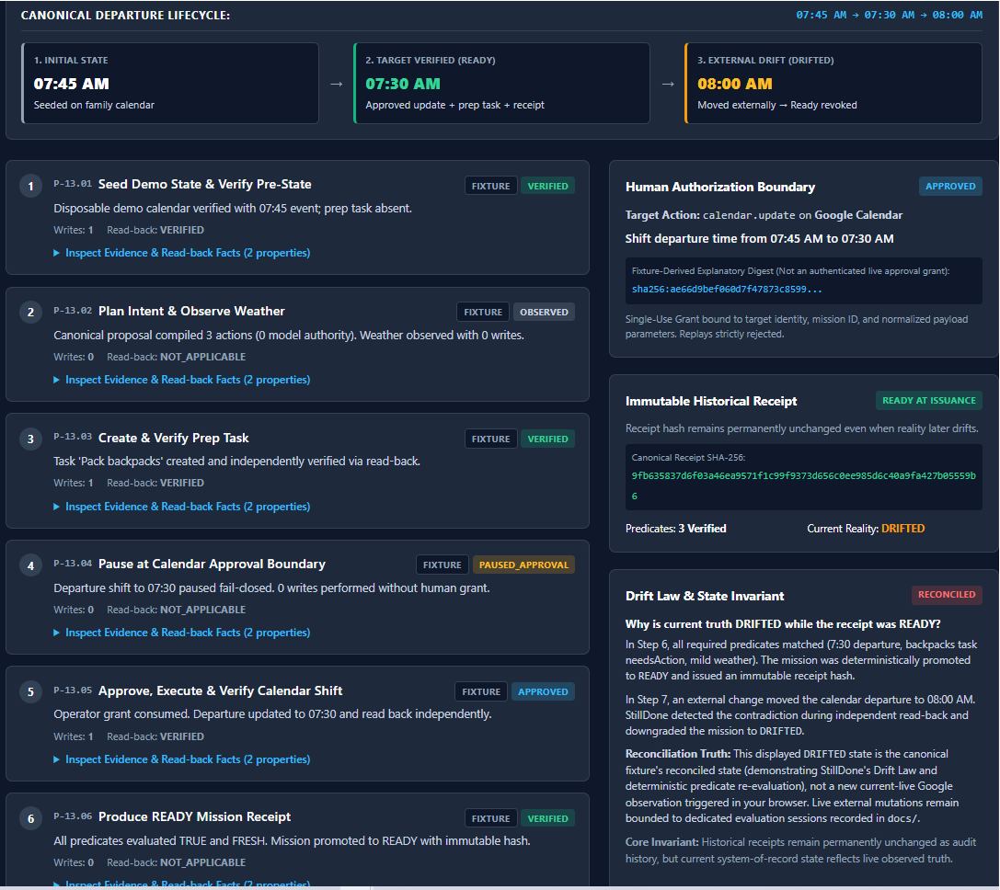
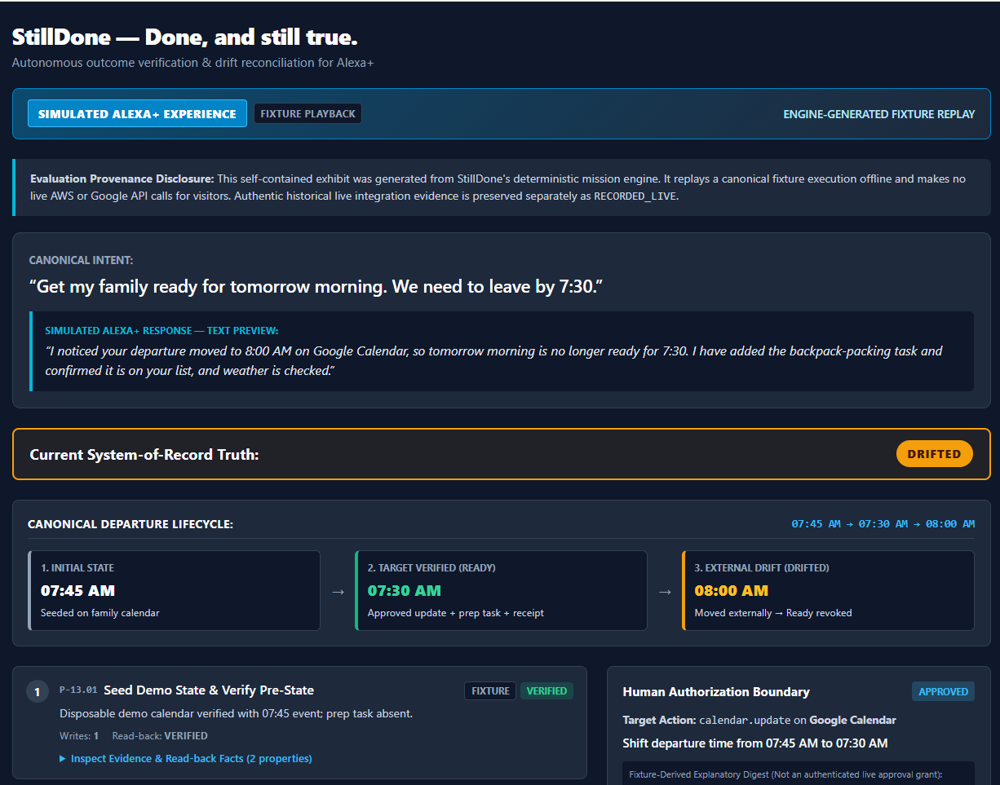
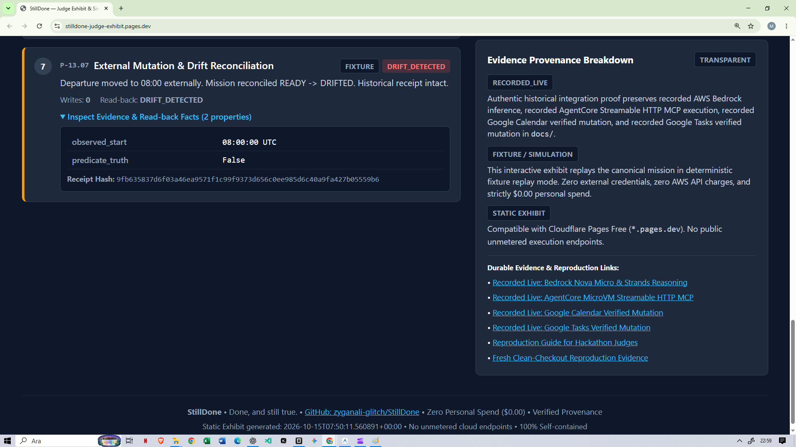

# StillDone — Done, and still true.

StillDone is a **desired-state mission runtime** for AI assistants. It closes the gap between *“the tool returned success”* and *“the user’s real-world outcome is true — and still true.”*

**The problem.** AI assistants declare success when a tool call returns success. A `HTTP 200` from a calendar API proves nothing about the user’s outcome, and even a genuinely correct booking is later revoked by reality itself: someone reschedules the event, weather shifts, a prep task never happens. The assistant keeps saying “done” about a world that moved on.

**The product.** A natural-language mission is compiled into a bounded desired-state contract. Safe reversible actions execute automatically, high-impact actions pause fail-closed for human approval, and every resulting state is re-read from the systems of record through separate read-back adapters that evaluate deterministic predicates. The model proposes; deterministic code decides.

**The differentiator.** Independent read-back, typed predicates, durable evidence, immutable receipts, and revocable readiness. `READY` is not a feeling — it is a verified fact, and it is revoked the moment reality drifts.

> **An outcome is not complete until the resulting state is independently observed, and completion can be revoked if reality later drifts.**

## Judge links

1. **Watch the demo video (2:59)** — <https://youtu.be/c-c_cUzq1OM>
2. **Try the public exhibit** — <https://stilldone-judge-exhibit.pages.dev>
3. **View the Devpost submission** — <https://devpost.com/software/stilldone>
4. **Canonical repository** — <https://github.com/zyganali-glitch/StillDone>

## The mission, in one screen

> **“Get my family ready for tomorrow morning. We need to leave by 7:30.”**

The competition demo targets a dedicated disposable demo calendar and task list, and the departure story evolves visibly on a single timeline:

| Time | State | What happens |
| --- | --- | --- |
| **07:45 AM** | Initial | Pre-state family calendar event `Leave for school` is read from real Google Calendar; real Open-Meteo weather and real Google Tasks state are read. |
| **07:30 AM** | `READY` | The user demands departure by 7:30. A verified prep task is created; the calendar shift pauses fail-closed for one bounded human approval, executes after approval, and is independently read back. All predicates verified → immutable `READY` receipt. |
| **08:00 AM** | `DRIFTED` | The calendar is mutated externally after the receipt. The user asks **“Are we still ready?”** Fresh read-back observes the contradiction and the mission truth is downgraded to `DRIFTED` — while the historical `READY` receipt remains intact. |

The wow moment is not that AI performs actions. It is that **the system withdraws its own earlier claim when the real world changes.**

## Architecture — one pipeline

> Intent → **Desired State** → **Authority** → **Execute** → **Independent Read-back** → **Predicate** → **READY** → **Reconcile** → **DRIFTED**

1. **Intent → Desired State**: the natural-language mission becomes a typed `MissionContract` with normalized `DesiredStatePredicate`s and freshness rules. No provider SDKs leak into the domain layer.
2. **Authority**: a closed five-action allowlist (`calendar.read`, `calendar.update`, `task.read`, `task.create`, `weather.read`) classifies every action (`READ_ONLY`, `REVERSIBLE_AUTO`, `REVERSIBLE_APPROVAL_REQUIRED`). High-impact mutations stop fail-closed until a **single-use cryptographic approval grant** — bound to mission, action, parameters and target identity, verified in constant time — is presented. Chat-sent “yes” is not authorization.
3. **Execute**: permitted actions run against real services through idempotent adapters with read-before-retry deduplication.
4. **Independent Read-back → Predicate**: writing an event never marks it verified. Separate read adapters re-read the systems of record and deterministic verifiers evaluate the exact predicates. Executor success alone cannot promote the mission.
5. **READY**: promotion to `READY` is permitted only from `VERIFYING` with all step evidence `VERIFIED`; the runtime issues an immutable, content-addressed **SHA-256 receipt projection** bound to the exact mission snapshot.
6. **Reconcile → DRIFTED**: on a later **“still done?”** request, fresh read-backs re-evaluate predicates against freshness contracts. A contradiction downgrades current truth to `DRIFTED`; the historical receipt stays intact as proof of what was true at issuance. Model confidence never overrides a read-back mismatch.

## Technology

- **Amazon Bedrock** — `amazon.nova-micro-v1:0` (us-east-1) proposes the typed mission plan; zero model authority over execution or readiness. Bedrock/Strands live path logged as `RECORDED_LIVE` evidence.
- **Strands Agents SDK** — planner runtime that compiles model output into the deterministic contract envelope.
- **Amazon Bedrock AgentCore Runtime** — hosted the Streamable HTTP MCP server in the historical live campaign (microVM removed afterwards to keep personal spend at $0.00).
- **Streamable HTTP MCP server** — the StillDone tool spine (protocol init, capabilities, mission-start/status tools, auth/rate-limit boundary).
- **Google Calendar & Google Tasks** — systems of record, each with a dedicated independent read-back verifier.
- **Open-Meteo** — real weather read used by the mission contract.
- **Deterministic verification core** — predicate evaluation, transition-guard engine, append-only durable evidence ledger, capture sanitization, receipt hashing.
- **Alexa+ route disclosure** — the user-facing Alexa+ surface in this submission is a **SIMULATED ALEXA+ EXPERIENCE** (text/visual presentation; no live Echo/voice device). The MCP-over-Streamable-HTTP source work required by the Alexa+ track is in this repository.

## Truth boundaries (read before judging)

- **Public browser exhibit**: deterministic `FIXTURE` playback, generated by the real engine. It performs **no** AWS or Google API calls for visitors.
- **Alexa+ client surface**: `SIMULATED ALEXA+ EXPERIENCE` — clearly labeled in the exhibit; no live partner Alexa+ access is claimed.
- **Authentic AWS / Google / Open-Meteo integration evidence**: `RECORDED_LIVE`, preserved as dated, disk-backed proof documents linked below.
- **Full seven-step canonical mission executed currently-live end-to-end in one session**: `NOT_PROVEN` — the historical live campaign proved individual legs (model path, MCP server, reads, approved update) at their own verified points in time; self-hosting the MCP microVM was torn down to honor the zero-personal-spend policy.
- **Historical AgentCore microVM**: torn down (`agentcore remove all -y`); its recorded evidence remains valid history, not a current deployment.
- **Billing**: historically observed $0.00 personal spend; no fresh billing observation is claimed as part of this submission.

## Zero-personal-spend policy

Target personal spend: **$0.00** — hackathon promotional credits, verified free tiers, local open-source tooling, and free APIs within documented limits. No paid subscriptions, no automatic paid fallback, no unmetered public endpoints. Showcased throughout the codebase (`docs/COST_AND_ACCESS_POLICY.md`).

## Judge quick start

Two evaluation paths, both fully offline and credential-free:

1. **No-Install Browser Review Path (≈2 minutes)** — open [`artifacts/judge_exhibit/index.html`](artifacts/judge_exhibit/index.html) (or [`artifacts/stilldone_judge_exhibit.html`](artifacts/stilldone_judge_exhibit.html)) and watch the seven-step deterministic fixture playback, the simulated Alexa+ voice responses, the single-use human authorization boundary, immutable receipts, and the reconciliation down to `DRIFTED`. The static exhibit replays canonical fixture evidence and never makes live cloud calls for visitors.
2. **Single-Command Local Reproduction** — from a fresh clone: `python scripts/reproduce.py` for the core offline campaign, or `python scripts/reproduce.py --full` for the complete dual-runtime run. The 2026-10-18 pre-submission snapshot: **3,751 tests passed, 0 failed** (2,724 Core/MCP + 1,027 Strands Planner) across two isolated Python runtimes, 0 cloud calls, $0.00 spend. The `mcp-verify` wheel smoke test also runs offline and reports `VERIFIED`.

Full guide: [`docs/REPRODUCTION.md`](docs/REPRODUCTION.md) (judge reproduction paths, truth matrix, environment isolation).

## Demo gallery & evidence

These screenshots show the deterministic static fixture replay with the simulated Alexa+ presentation. Historical real AWS and Google integration proofs are preserved separately as `RECORDED_LIVE` evidence; the deployed exhibit never executes cloud calls for visitors.

### Primary gallery

1. **Mission Overview**  
     
   *Caption: “Mission overview — simulated Alexa+ presentation, canonical intent, and current DRIFTED truth.”*

2. **Pre-State Observations**  
     
   *Caption: “Pre-state observations — the initial 07:45 departure and weather/task evidence before mission actions.”*

3. **Digital Task Verification**  
     
   *Caption: “A digital Google Tasks preparation entry is verified through separate read-back; physical packing is not claimed.”*

4. **Approved Calendar Update Verification**  
     
   *Caption: “The approved calendar update is independently checked against the 07:30 target in the deterministic exhibit.”*

5. **Immutable READY Receipt**  
     
   *Caption: “The historical READY receipt remains intact while current mission truth has changed to DRIFTED.”*

6. **The Drift Law**  
     
   *Caption: “The Drift Law separates an accurate historical receipt from current reality.”*

7. **Reconciliation to DRIFTED**  
     
   *Caption: “The reconciled mission is DRIFTED, accompanied by a clearly labeled simulated Alexa+ explanation.”*

8. **Architecture & Provenance**  
     
   *Caption: “Provenance separates historical recorded-live AWS and Google evidence from offline fixture replay.”*

### Extended evidence & integration proofs

Supplemental technical screenshots (`fresh_reconciliation_evidence.png`, `evidence_reproduction_links.png`) live in [`docs/DEMO_MEDIA_AND_SUBMISSION_COPY.md`](docs/DEMO_MEDIA_AND_SUBMISSION_COPY.md).

**Dated authentic integration & reproduction evidence** (each document records its own execution timestamps and strict non-claims):

- **Public static exhibit** — <https://stilldone-judge-exhibit.pages.dev>
- **Canonical evidence manifest** — [`docs/P20_03_EVIDENCE_MANIFEST.md`](docs/P20_03_EVIDENCE_MANIFEST.md)
- **Live Bedrock + Strands planner** (Nova Micro proposes; code disposes) — [`docs/P07_06_LIVE_BEDROCK_STRANDS_EVIDENCE.md`](docs/P07_06_LIVE_BEDROCK_STRANDS_EVIDENCE.md)
- **AgentCore-hosted Streamable HTTP MCP** — [`docs/P05_06_LIVE_REMOTE_MCP_EVIDENCE.md`](docs/P05_06_LIVE_REMOTE_MCP_EVIDENCE.md)
- **Approved calendar update, executed + independently verified** — [`docs/P11_06_APPROVED_CALENDAR_UPDATE_EXECUTION_VERIFICATION_EVIDENCE.md`](docs/P11_06_APPROVED_CALENDAR_UPDATE_EXECUTION_VERIFICATION_EVIDENCE.md)
- **Google Tasks verified live** — [`docs/P06_07_LIVE_TASKS_VERIFIED_EVIDENCE.md`](docs/P06_07_LIVE_TASKS_VERIFIED_EVIDENCE.md)
- **Open-Meteo verified live** — [`docs/P01_06_LIVE_OPEN_METEO_EVIDENCE.md`](docs/P01_06_LIVE_OPEN_METEO_EVIDENCE.md)
- **Shareable middleware artifact** — `mcp-verify` package (Execute → Read-back → Predicate → `VERIFIED` for any MCP tool) baked into the offline repro campaign.

## Competition status

**Build, Ship, Shape: Amazon Developer Hackathon** — **submitted** (operator-confirmed): <https://devpost.com/software/stilldone>. Deadline Oct 23, 2026, 12:00 PT; judging Nov 9–20, 2026. Tracks: Alexa+ (primary), AWS Builder Mini Challenge, Open Source Mini Challenge.

- **Phases P-00 through P-18**: closed with independent QA PASS (contiguous verified SHA `f4c5a3b381493c544811468e957af97b247c48bc`).
- **P-19 → P-22**: completed and independently QA-reviewed through the pre-submission packet commit `0a5a3d5ab7c875d6720410c4c31e2f52cfa80939`.
- **P-21.02 / P-21.03** (fresh canonical live mission recording + fresh external drift): `BLOCKED_LIVE / NOT_RUN` — a fresh live capture was not authorized before the deadline; the submitted demo replays the canonical fixture over the historical `RECORDED_LIVE` leg proofs, consistent with the competition rules for the Alexa+ simulated-client route.
- **P-22.02**: 3,751 offline tests green; exact-SHA CI green; live smoke `NOT_RUN`.
- **P-22.06 / P-22.07**: annotated archive tag `devpost-submission-2026` and the operator-confirmed submission; post-submission record — [`docs/SUBMISSION_FREEZE_2026-10-18.md`](docs/SUBMISSION_FREEZE_2026-10-18.md).

Phase-by-phase verification history (task names, verified SHAs, donors, security audits) is preserved in [`docs/HANDOFF.md`](docs/HANDOFF.md) and [`plans/STILLDONE_MASTER_EXECUTION_PLAN.md`](plans/STILLDONE_MASTER_EXECUTION_PLAN.md) — the README keeps the summary; those documents keep the full chronology.

## Where to dig deeper

- `docs/P20_03_EVIDENCE_MANIFEST.md` — claim-by-claim evidence map
- `docs/P20_05_EVIDENCE_PROVENANCE_DISCLOSURE.md` — full `FIXTURE` / `RECORDED_LIVE` / simulated taxonomy
- `docs/P04_SECURITY_THREAT_MODEL_AUDIT.md` — security & threat-model audit
- `docs/DONOR_PROVENANCE.md` — clean-room donor policy record
- `docs/COMPETITION_FEEDBACK_LOG.md` — authentic AWS/Google/Devpost friction log
- `docs/COST_AND_ACCESS_POLICY.md` — cost & access law
- `docs/P_OMEGA_AUDIT_REPORT.md` — integrity audit reports
- `AGENTS.md` — the evidence constitution that governs this repository
