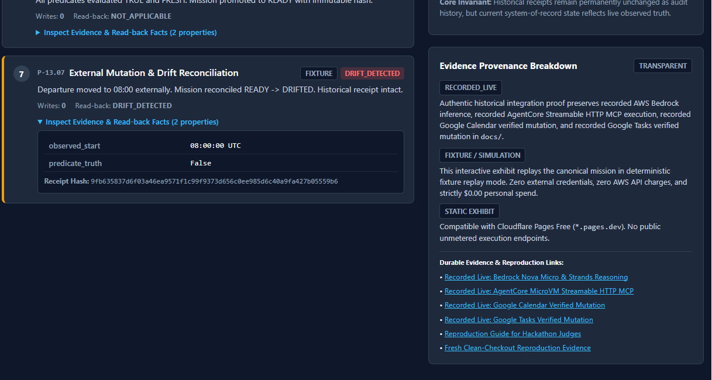

# DEMO MEDIA MANIFEST, README GALLERY & SUBMISSION COPY REGISTRY

**Document ID**: `docs/DEMO_MEDIA_AND_SUBMISSION_COPY.md`  
**Repository**: `zyganali-glitch/StillDone`  
**Branch**: `main`  
**Last Independently QA-Verified SHA**: `b30052b9e7ac650b6a12f3a926ef5c201d632f6a`  
**Governing Authority**: `AGENTS.md` § 3 (Closure Contract), § 4 (Core Product Invariant), § 9 (Live-First Law), § 10 (Evidence Provenance), § 12 (Zero Personal Spend Law); `plans/STILLDONE_MASTER_EXECUTION_PLAN.md` § P-21; `docs/P21_01_DEMO_SCRIPT_AND_SHOT_LIST.md`  
**Status**: `BOUNDED DOCUMENTATION, MEDIA-ASSET INTEGRATION & VALIDATION`  
**Target Video Duration**: 165 seconds (2:45) (Official rule: Under 3 minutes / < 180s)  
**Personal Spend**: `$0.00` target maintained  

---

## 1. Final Operator Decisions

These authoritative operator decisions supersede optional material in earlier shot lists:

1. **Clip Recording Completed**: All eight baseline demo clips have been successfully recorded by the operator using Clipchamp. Their presence, byte sizes, and container formats are verified from local disk; no claim of autonomous visual content review is made beyond disk preflight and exhibit frame inspection.
2. **No Additional Video Recording**: No additional video recording sessions are required.
3. **No Live Cloud Calls During Media Integration**: Strictly NO live AWS, Google, Calendar, Tasks, Bedrock, AgentCore, or Alexa+ network calls are executed during this documentation and asset integration pass.
4. **No Ancillary Console Video Clips**: NO extra terminal, AWS console, or Google Calendar video clips are appended to the baseline sequence.
5. **No Separate Closing Title Card**: Scene 08 ends strictly on the public exhibit's Evidence Provenance and GitHub open-source evidence-links section. No separate standalone StillDone title-card video clip is produced or inserted.
6. **Exhibit Footage Integrity**: Scene 08 concludes using the actual recorded public exhibit's Evidence Provenance card (`#prov-title`), footer, and GitHub links.
7. **No Fabricated Live Transitions**: No fabricated live animations, synthetic live transitions, or simulated voice synthesis in code.
8. **Operator-Edited in Clipchamp**: The final video montage is personally edited, sequenced, and exported by the operator in Microsoft Clipchamp.
9. **Honest Production Gate Status**: TTS voiceover synthesis, final audio alignment, video export, public YouTube upload, and final playback verification remain explicitly `NOT_RUN` / `PENDING_OPERATOR_ACTION` until independently demonstrated.
10. **Evidence Provenance Separation**: Authentic historical integration evidence is categorized strictly as `RECORDED_LIVE`, completely separate from the deterministic `FIXTURE` playback demonstrated in the public exhibit.
11. **Zero Personal Spend**: Strict `$0.00` personal spend target. No paid subscriptions, paid upgrades, or commercial services used.

---

## 2. Exact Clipchamp Edit Decision List (EDL)

The official competition limit is under 3 minutes (< 180s). The frozen StillDone editorial target is **165 seconds (2 minutes 45 seconds)**.

### Master Timeline & Assembly Table

| Final Timeline | Source Clip | Narration Audio File | Visual Focus / Action |
|---|---|---|---|
| **00:00–00:15** (15s) | `15.10.2026 21_08_15 - Screen - Video Project 38.webm` (Scene `01` recorded intro) | `01_voiceover.mp3` (36 words) | Exhibit brand header (`.brand-header`), tagline *"Done, and still true."*, and evaluation provenance notice (`.fixture-notice`). |
| **00:15–00:40** (25s) | `02_prestate_reads.webm` | `02_voiceover.mp3` (52 words) | Canonical intent, Departure Lifecycle Tracker Node 1 (07:45 AM), expanded Step 1 and Step 2 pre-state evidence tables. |
| **00:40–01:05** (25s) | `03_bedrock_tasks.webm` | `03_voiceover.mp3` (54 words) | Step 2 `model_authority: ZERO`, Step 3 digital Google Tasks creation, distinct read-back badge (`VERIFIED`). |
| **01:05–01:35** (30s) | `04_calendar_approval.webm` | `04_voiceover.mp3` (62 words) | Step 4 fail-closed pause (`PAUSED_APPROVAL`, 0 writes), sidebar Human Authorization Boundary card, Step 5 approved shift and read-back proof. |
| **01:35–01:55** (20s) | `05_ready_receipt.webm` | `05_voiceover.mp3` (44 words) | Step 6 verified predicates (3/3), sidebar Immutable Historical Receipt card with `READY AT ISSUANCE` badge and canonical SHA-256 hash. |
| **01:55–02:03** (8s) | `06a_departure_timeline.webm` (or `06_departure_drift_combined.webm` part 1) | Start `06_voiceover.mp3` (43 words total) | Departure Lifecycle Tracker Node 3: 08:00 AM External Drift highlight. |
| **02:03–02:15** (12s) | `06b_drift_law.webm` (or `06_departure_drift_combined.webm` part 2) | Continue `06_voiceover.mp3` | Sidebar Drift Law & State Invariant card (`#drift-title`), explanation of why current truth is DRIFTED while receipt was READY. |
| **02:15–02:23** (8s) | `07a_current_truth.webm` (or `07_reconciliation_drifted_combined.webm` part 1) | Start `07_voiceover.mp3` (43 words total) | Hero Status Bar amber `DRIFTED` pill and Alexa+ Voice Summary card explanation. |
| **02:23–02:31** (8s) | `07b_reconciliation.webm` (or `07_reconciliation_drifted_combined.webm` part 2) | Continue `07_voiceover.mp3` | Step 7 expanded evidence table (`observed_start: 08:00:00 UTC`, `predicate_truth: False`, badge `DRIFT_DETECTED`). |
| **02:31–02:35** (4s) | Still image `docs/assets/readme/immutable_ready_receipt.png` | Continue `07_voiceover.mp3` | High-resolution freeze showing intact historical receipt hash `87720e51...` on disk. |
| **02:35–02:45** (10s) | `08_architecture_closing.webm` (Exhibit footage ONLY) | `08_voiceover.mp3` (22 words) | Public exhibit Evidence Provenance Breakdown (`#prov-title`), zero personal spend footer, and GitHub repository links. No separate title card. |

### Discovered Scene 01 Source Identity
- **Original Local Recording Name**: `15.10.2026 21_08_15 - Screen - Video Project 38.webm` (discovered from operator's actual Clipchamp export in local storage; 2,626,429 bytes).
- **Normalized Working Name**: `01_recorded_intro.webm` (stored in `_local_media/raw_clips/`).

### Canonical Media Directories (Git-Excluded)
- **Raw Recorded Clips**: `_local_media/raw_clips/`
- **Spoken Voiceover Audio**: `_local_media/voiceover/`
- **Subtitle / Caption Files**: `_local_media/captions/`
- **Master Final Export**: `_local_media/final_export/`

### Approved Canonical Narration Script (356 Words, Unaltered)
```text
[0:00 - 0:15]
Today's AI assistants treat an API HTTP 200 as mission complete. But tool success is not real-world verification. Welcome to StillDone: an autonomous runtime where outcomes require independent observation, and completion is revoked if reality drifts.

[0:15 - 0:40]
Our mission: "Get my family ready for tomorrow morning. We need to leave by 7:30." In StillDone's Streamable HTTP MCP architecture, the runtime begins by observing ground truth. Replaying canonical pre-state observations, tomorrow's departure is scheduled for 7:45 AM, and weather indicates morning rain. StillDone requires real pre-state before proposing any action.

[0:40 - 1:05]
Amazon Bedrock Nova Micro compiles the intent into a typed proposal. But the model has zero execution authority. Replaying recorded live execution, StillDone creates a digital preparation task in Google Tasks: "Pack backpacks." Write success is never verification. A separate read adapter reads back the task list, verifying it is active before awarding progress.

[1:05 - 1:35]
Next, shifting departure from 7:45 to 7:30 is high impact. StillDone pauses fail-closed at the human authorization boundary with zero writes performed. A bound cryptographic approval card is emitted with an immutable SHA-256 fingerprint. Once the operator approves, StillDone consumes the single-use grant, executes the calendar update, and immediately invokes an independent read-back, verifying the 7:30 departure with recorded Google Calendar proof.

[1:35 - 1:55]
With weather checked, digital prep task verified, and departure confirmed at 7:30, all predicates evaluate true. StillDone deterministically promotes the mission to READY, issuing an immutable receipt with a SHA-256 hash anchored to the verified facts. But in real life, reality never stands still.

[1:55 - 2:15]
Later that evening, reality changes. As tracked in our departure lifecycle, an external reschedule moves departure to 8:00 AM. Ordinary agents would still report mission complete based on old execution logs. But StillDone enforces the Drift Law: historical receipts never override current truth.

[2:15 - 2:35]
When asked, "Are we still ready?", StillDone evaluates fresh read-back proof. The departure predicate fails. Instantly, StillDone revokes readiness, downgrading current state to DRIFTED and explaining what changed. Meanwhile, the historical receipt hash remains cryptographically intact on disk as an immutable audit record.

[2:35 - 2:45]
Built with Amazon Bedrock, AgentCore, and Streamable HTTP MCP, backed by comprehensive automated tests. Make sure it's StillDone: Done, and still true.
```

---

## 3. YouTube Metadata — Exact Final Copy

### Title
```text
StillDone — Verified AI Missions, Even After Drift | Amazon Developer Hackathon
```

### Description
```text
StillDone — Done, and still true.

AI agents should not claim a mission is complete just because an API call succeeded.

StillDone is a desired-state mission runtime that separates AI planning from execution authority, requires human approval for sensitive changes, independently verifies external state, and preserves durable evidence. When reality changes, StillDone can revoke an earlier READY result and reconcile the mission to DRIFTED.

In this demo, a family needs to leave by 7:30 AM. StillDone demonstrates the journey from an initial 7:45 departure to a verified 7:30 target, followed by an external change to 8:00 and a fresh reconciliation.

Watch the demo:
00:00 — Why API success is not verification
00:15 — Mission intent and pre-state observations
00:40 — Amazon Bedrock planning and Google Tasks
01:05 — Human approval and verified calendar update
01:35 — READY and immutable SHA-256 receipt
01:55 — External calendar drift
02:15 — Fresh reconciliation to DRIFTED
02:35 — Architecture, provenance, and open-source evidence

Try the public exhibit:
https://stilldone-judge-exhibit.pages.dev

Source code and reproducible evidence:
https://github.com/zyganali-glitch/StillDone

Important demonstration disclosure: The browser exhibit is a deterministic offline fixture replay with a clearly labeled simulated Alexa+ client experience. It does not perform live AWS or Google API calls for visitors. Authentic historical AWS Bedrock, AgentCore, Google Calendar, Google Tasks, and Open-Meteo integration evidence is preserved separately in the GitHub repository as RECORDED_LIVE. The full seven-step sequence shown in the exhibit is not represented as one current live end-to-end execution.

Created for the Build, Ship, Shape: Amazon Developer Hackathon.

#StillDone #AmazonDeveloperHackathon #AWS #Bedrock #MCP #AlexaPlus #OpenSource
```

### Publication Status
`PENDING_OPERATOR_ACTION / NOT_RUN` (Video editing, narration synthesis, and YouTube upload to be executed by the operator).

---

## 4. Devpost Short Description

### Exact Text
```text
StillDone verifies outcomes instead of trusting agent claims. It executes approved actions, reads reality back independently, issues durable receipts, and reconciles drift.
```

- **Character Count**: 169 characters (Verified $\le$ 200 characters).

---

## 5. Devpost Screenshot Inventory & Canonical Captions

All eight screenshots are preserved under `docs/assets/devpost/`. Every English caption is strictly bounded to $\le 200$ characters.

| # | Filename | Canonical Caption | Length |
|---|---|---|---|
| 1 | `scene_01_header_thesis.png` | StillDone's public exhibit: a simulated Alexa+ experience with deterministic fixture playback and transparent evidence provenance. | 130 chars |
| 2 | `scene_02_prestate_reads.png` | Pre-state evidence shows a 7:45 departure, an absent preparation task, and rainy weather before the mission's actions. | 118 chars |
| 3 | `scene_03_tasks_prep_verified.png` | The model proposes; deterministic code controls execution. A digital Google Tasks entry is verified through separate read-back. | 128 chars |
| 4 | `scene_04_approval_boundary.png` | Calendar mutation pauses at a human approval boundary. The exhibit records zero calendar writes before authorization. | 117 chars |
| 5 | `scene_05_ready_receipt.png` | Three verified predicates produce a historical READY receipt. Its SHA-256 hash stays intact even after later drift. | 115 chars |
| 6 | `scene_06_departure_drift_tracker.png` | The deterministic exhibit illustrates departure changing from verified 7:30 to 8:00, invalidating current readiness. | 116 chars |
| 7 | `scene_07_reconciliation_drifted.png` | Fresh fixture reconciliation marks current truth DRIFTED while preserving the historical READY receipt and simulated Alexa+ response. | 135 chars |
| 8 | `scene_08_architecture_closing.png` | The provenance card separates historical recorded-live AWS and Google integration evidence from offline fixture playback. | 122 chars |

*Note on Scene 08*: The filename `scene_08_architecture_closing.png` is historical; it corresponds to the public exhibit's Evidence Provenance and footer section, and does NOT imply a separate closing card.

---

## 6. README Screenshot Inventory & Captions

All ten screenshots are stored under `docs/assets/readme/`. The first eight are embedded directly in `README.md` as the primary gallery; the final two are supplemental images maintained in this extended registry.

### Primary Gallery (Embedded in README.md)
1. **`docs/assets/readme/stilldone_overview.png`**  
   *Caption*: Mission overview — simulated Alexa+ presentation, canonical intent, and current DRIFTED truth.  
   *Usage*: Top of gallery, establishing the simulated Alexa+ presentation and killer mission intent.
2. **`docs/assets/readme/prestate_verification.png`**  
   *Caption*: Pre-state observations — the initial 07:45 departure and weather/task evidence before mission actions.  
   *Usage*: Illustrates observing ground truth before taking any mutation action.
3. **`docs/assets/readme/task_verification.png`**  
   *Caption*: A digital Google Tasks preparation entry is verified through separate read-back; physical packing is not claimed.  
   *Usage*: Proves independent read-back verification of digital task creation.
4. **`docs/assets/readme/calendar_verified_update.png`**  
   *Caption*: The approved calendar update is independently checked against the 07:30 target in the deterministic exhibit.  
   *Usage*: Demonstrates human authorization boundary consumption, calendar update, and read-back proof.
5. **`docs/assets/readme/immutable_ready_receipt.png`**  
   *Caption*: The historical READY receipt remains intact while current mission truth has changed to DRIFTED.  
   *Usage*: Highlights the immutable SHA-256 receipt projection anchored to verified predicates.
6. **`docs/assets/readme/drift_law_explanation.png`**  
   *Caption*: The Drift Law separates an accurate historical receipt from current reality.  
   *Usage*: Focuses on the Departure Lifecycle Tracker and the Drift Law explanation card.
7. **`docs/assets/readme/current_truth_drifted.png`**  
   *Caption*: The reconciled mission is DRIFTED, accompanied by a clearly labeled simulated Alexa+ explanation.  
   *Usage*: Shows the amber DRIFTED status pill and transparent Alexa+ spoken explanation.
8. **`docs/assets/readme/architecture_provenance.png`**  
   *Caption*: Provenance separates historical recorded-live AWS and Google evidence from offline fixture replay.  
   *Usage*: Documents the transparent provenance classification card and $0.00 personal spend footer.

### Supplemental Images (Extended Media Gallery)
9. **`docs/assets/readme/fresh_reconciliation_evidence.png`**  
   *Caption*: Deterministic reconciliation observes the changed 08:00 departure and a failed readiness predicate.  
   *Usage*: Detailed zoom of Step 7 evidence table showing contradictory observation (`observed_start: 08:00:00 UTC`).  
   
10. **`docs/assets/readme/evidence_reproduction_links.png`**  
    *Caption*: Public links lead to durable integration evidence and instructions for reproducible verification.  
    *Usage*: Full provenance card displaying the GitHub links and reproduction instructions.  
    

---

## 7. Local Media Preflight Audit (18/18 Verified)

A comprehensive local disk preflight was executed prior to staging. All 18 PNG files are physically present on disk, valid, and verified:

```
Devpost Screenshot Set (8/8 Present & Valid):
- docs/assets/devpost/scene_01_header_thesis.png           (1920x1080, 159,597 bytes) -> VALID PNG
- docs/assets/devpost/scene_02_prestate_reads.png           (1920x1080, 171,875 bytes) -> VALID PNG
- docs/assets/devpost/scene_03_tasks_prep_verified.png      (1920x1080, 219,732 bytes) -> VALID PNG
- docs/assets/devpost/scene_04_approval_boundary.png        (1920x1080, 212,275 bytes) -> VALID PNG
- docs/assets/devpost/scene_05_ready_receipt.png            (1920x1080, 238,459 bytes) -> VALID PNG
- docs/assets/devpost/scene_06_departure_drift_tracker.png  (1087x968,  158,926 bytes) -> VALID PNG
- docs/assets/devpost/scene_07_reconciliation_drifted.png   (1226x963,   92,503 bytes) -> VALID PNG
- docs/assets/devpost/scene_08_architecture_closing.png     (1920x1080, 206,634 bytes) -> VALID PNG

README Screenshot Set (10/10 Present & Valid):
- docs/assets/readme/stilldone_overview.png                 (1920x1080, 182,236 bytes) -> VALID PNG
- docs/assets/readme/prestate_verification.png              (1920x1080, 171,875 bytes) -> VALID PNG
- docs/assets/readme/task_verification.png                  (1920x1080, 219,732 bytes) -> VALID PNG
- docs/assets/readme/calendar_verified_update.png           (1920x1080, 215,296 bytes) -> VALID PNG
- docs/assets/readme/immutable_ready_receipt.png            (1920x1080, 238,459 bytes) -> VALID PNG
- docs/assets/readme/drift_law_explanation.png              (1087x968,  158,926 bytes) -> VALID PNG
- docs/assets/readme/current_truth_drifted.png              (1226x963,  120,897 bytes) -> VALID PNG
- docs/assets/readme/fresh_reconciliation_evidence.png      (1217x650,   82,366 bytes) -> VALID PNG
- docs/assets/readme/architecture_provenance.png            (1920x1080, 206,634 bytes) -> VALID PNG
- docs/assets/readme/evidence_reproduction_links.png        (1920x1080, 206,634 bytes) -> VALID PNG
```

### Privacy & PII Inspection Findings
- **Metadata Chunks**: Standard clean chunk headers only (`srgb`, `gamma`, `dpi`). Zero user text chunks, EXIF user comments, GPS coordinates, or author tags.
- **Browser UI & Chrome Profile**: Standard navigation bar showing `stilldone-judge-exhibit.pages.dev`; avatar displays default letter "M" without full name, email, or credentials.
- **Windows Taskbar**: Clean system icons; no personal documents or sensitive application titles.
- **Secrets & Keys**: Zero AWS access key prefixes, Google OAuth tokens, API keys, passwords, or `.env` paths exposed.

---

## 8. Honest Production Gate Status

In compliance with `AGENTS.md` § 3 (Closure Contract):

| Gate / Activity | Target Outcome | Current Status | Responsible Party |
|---|---|---|---|
| **Raw Baseline Clips** | 8 baseline recordings matching canonical scenes | `REPORTED_RECORDED` (Files verified on disk) | Operator |
| **Media Manifest & Captions** | Exact EDL, YouTube copy, Devpost captions $\le 200$ chars | `COMPLETED` | Coding Agent |
| **Local Image Preflight** | 18/18 valid PNGs verified, privacy-inspected | `COMPLETED` | Coding Agent |
| **README Gallery Integration** | 8 principal images embedded, 2 supplemental linked | `COMPLETED` | Coding Agent |
| **Audio Voiceover Synthesis (TTS)** | 8 MP3 voiceover files matching approved script | `NOT_RUN / PENDING_OPERATOR_ACTION` | Operator |
| **Final Video Assembly & Master Export** | 165s master MP4 in Clipchamp | `NOT_RUN / PENDING_OPERATOR_ACTION` | Operator |
| **Public YouTube Upload** | Public unlisted/public video URL | `NOT_RUN / PENDING_OPERATOR_ACTION` | Operator |
| **Devpost Final Submission** | Form fields and asset submission | `NOT_RUN / PENDING_OPERATOR_ACTION` | Operator |
